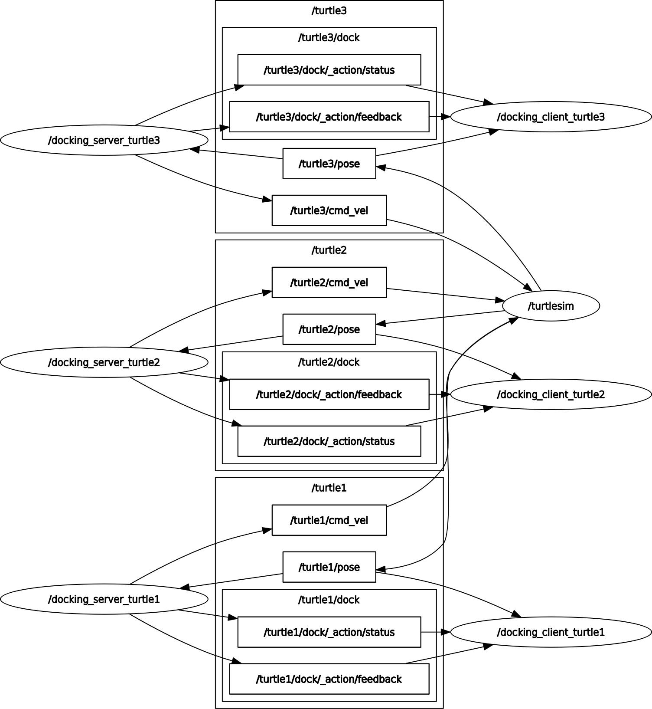

# ENG612 Project 1 — Docking Multiple TurtleSim Robots

A ROS 2 multi-robot docking system developed for **ENG612 – Autonomous Systems** at **Murdoch University**.

The project demonstrates how three TurtleSim robots can be spawned at predefined locations and commanded to move simultaneously toward separate docking stations using a **fixed-velocity, open-loop Go-to-Goal strategy**.

The system integrates several core ROS 2 concepts, including:

- ROS 2 Services
- ROS 2 Actions
- Publisher–Subscriber communication
- YAML Parameters
- Topic Remapping
- Launch Files
- TurtleSim
- `rqt_graph`
- Multi-robot coordination

---

## Project Objective

The objective of this project is to:

1. Spawn three TurtleSim robots at predefined initial poses.
2. Assign each turtle a dedicated docking station.
3. Move all three turtles simultaneously.
4. Use only fixed linear and angular velocities.
5. Prevent the turtles from reaching crossing points at the same time.
6. Complete the docking operation without a feedback controller or corrective steering.
7. Align each turtle with the required final docking orientation.
8. Run the complete ROS 2 system from a single launch file.

---

## Turtle Initial and Docking Poses

| Turtle | Initial Pose `(x, y, θ)` | Docking Pose `(x, y, ψ)` |
|---|---|---|
| Turtle 1 | `(5.0, 1.0, 0.0)` | `(5.0, 9.0, -1.57)` |
| Turtle 2 | `(10.0, 1.0, 0.0)` | `(1.0, 7.0, -0.78)` |
| Turtle 3 | `(1.0, 1.0, 0.0)` | `(9.0, 7.0, -2.35)` |

---

## System Architecture

The project uses the following ROS 2 communication structure:

```text
                         params.yaml
                              |
                              v
                         Launch File
                              |
          +-------------------+-------------------+
          |                   |                   |
          v                   v                   v
     Spawn Service        Action Nodes        TurtleSim
          |                   |
          v                   v
    Spawn Turtles       Send Docking Goal
                              |
                              v
                        Action Server
                         /          \
                        /            \
                       v              v
                 /pose Subscriber   /cmd_vel Publisher
                       |              |
                       +---- TurtleSim
```

Each turtle has:

```text
Action Client
     |
     | Docking Goal
     v
Action Server
     |
     +---- subscribes to ----> /turtleX/pose
     |
     +---- publishes to -----> /turtleX/cmd_vel
     |
     +---- sends -----------> Action Feedback
     |
     +---- returns ---------> Action Result
```

---

## ROS 2 Components Used

### 1. ROS 2 Service

A custom service named:

```text
/spawn_turtle
```

is used to spawn the turtles.

The service receives:

```text
x
y
theta
name
```

The project spawning node then forwards the request to TurtleSim's built-in `/spawn` service.

TurtleSim initially creates a default `turtle1` near the centre of the simulator. The project removes this turtle using `/kill` and recreates `turtle1` at the required initial position.

---

### 2. ROS 2 Actions

A custom Action called:

```text
Docking.action
```

is used to perform the docking task.

The Action contains:

```text
# Goal
float32 x
float32 y
float32 psi

---
# Result
bool success
string message

---
# Feedback
float32 current_x
float32 current_y
float32 current_theta
float32 distance_remaining
string stage
```

Each turtle has its own Action name:

```text
/turtle1/dock
/turtle2/dock
/turtle3/dock
```

The Action Client sends the docking goal.

The Action Server performs the docking sequence and sends feedback during execution.

---

## Publisher–Subscriber Communication

Each Action Server communicates with TurtleSim using two main topics.

### Pose Topic

The Action Server subscribes to:

```text
/turtle1/pose
/turtle2/pose
/turtle3/pose
```

The pose information provides:

```text
x
y
theta
```

This information is used to monitor the turtle position and generate Action feedback.

---

### Velocity Command Topic

The Action Server publishes `geometry_msgs/msg/Twist` messages to:

```text
/turtle1/cmd_vel
/turtle2/cmd_vel
/turtle3/cmd_vel
```

The main velocity fields are:

```text
linear.x
angular.z
```

For straight movement:

```text
linear.x  = fixed value
angular.z = 0
```

For rotation:

```text
linear.x  = 0
angular.z = fixed value
```

To stop:

```text
linear.x  = 0
angular.z = 0
```

---

## Open-Loop Go-to-Goal Strategy

The project uses a strict fixed-velocity open-loop control strategy.

The movement is divided into three stages.

### Stage 1 — Initial Heading

The desired heading is calculated using:

```text
θd = atan2(yd - yc, xd - xc)
```

where:

```text
xd, yd = docking position
xc, yc = current turtle position
```

The turtle rotates toward the required heading using a fixed angular velocity.

---

### Stage 2 — Straight-Line Translation

After the initial rotation, the turtle moves forward using a fixed linear velocity.

```text
linear.x  = fixed velocity
angular.z = 0
```

No corrective steering is applied during the straight-line motion.

---

### Stage 3 — Final Docking Orientation

After reaching the docking position, the turtle performs a final rotation until it reaches the required docking orientation:

```text
ψ
```

The turtle then publishes zero velocity and the docking Action is completed.

---

## Multi-Robot Collision Prevention

The three planned trajectories cross near the centre of the TurtleSim environment.

Instead of implementing an obstacle-avoidance algorithm, the project uses different fixed linear velocities for the three turtles.

| Turtle | Linear Velocity |
|---|---:|
| Turtle 1 | `0.40` |
| Turtle 2 | `0.20` |
| Turtle 3 | `0.25` |

All turtles use:

```text
angular_velocity = 0.25 rad/s
```

Using different fixed linear velocities ensures that the turtles do not arrive at the route crossing points at the same time.

This maintains the required open-loop control strategy without introducing PID, path planning, SLAM, or advanced obstacle avoidance.

---

## ROS 2 Parameters

The main configuration values are stored in:

```text
config/params.yaml
```

Parameters include:

- Initial turtle poses
- Docking poses
- Linear velocity
- Angular velocity
- Position tolerance
- Angle tolerance
- Action names

Using parameters allows the same controller implementation to be reused for multiple turtles.

---

## Topic Remapping

The same docking Action Server implementation is reused for all three turtles.

The launch file remaps the generic topics:

```text
pose
cmd_vel
```

to the appropriate turtle namespace.

For Turtle 1:

```text
pose    -> /turtle1/pose
cmd_vel -> /turtle1/cmd_vel
```

For Turtle 2:

```text
pose    -> /turtle2/pose
cmd_vel -> /turtle2/cmd_vel
```

For Turtle 3:

```text
pose    -> /turtle3/pose
cmd_vel -> /turtle3/cmd_vel
```

This avoids creating separate controller programs for each robot.

---

## Package Structure

```text
project1/
│
├── action/
│   └── Docking.action
│
├── config/
│   └── params.yaml
│
├── launch/
│   └── project1_docking.launch.py
│
├── src/
│   ├── spawn_turtle_service.py
│   ├── spawn_turtle_client.py
│   ├── docking_action_server.py
│   └── docking_action_client.py
│
├── rosgraph.png
├── rosgraph.svg
├── CMakeLists.txt
└── package.xml
```

---

## File Description

### `spawn_turtle_service.py`

Creates the custom:

```text
/spawn_turtle
```

service and communicates with TurtleSim's `/spawn` service.

---

### `spawn_turtle_client.py`

Reads the required initial poses from the YAML parameters and sends spawn requests for:

```text
turtle1
turtle2
turtle3
```

It also removes the default TurtleSim `turtle1` before recreating it at the required starting position.

---

### `docking_action_server.py`

Main motion-control node.

Responsibilities include:

- Receiving docking goals
- Reading turtle pose
- Calculating the required heading
- Publishing fixed velocity commands
- Executing straight-line movement
- Executing final orientation alignment
- Publishing Action feedback
- Returning the final docking result

---

### `docking_action_client.py`

Sends each turtle its assigned docking goal.

It also receives:

- Goal acceptance
- Action feedback
- Final docking result

---

### `Docking.action`

Defines the custom ROS 2 Action interface containing:

```text
Goal
Result
Feedback
```

---

### `params.yaml`

Stores robot-specific configuration values.

---

### `project1_docking.launch.py`

Starts the complete system, including:

- TurtleSim
- Spawn Service
- Spawn Client
- Three Docking Action Servers
- Three Docking Action Clients
- Parameters
- Topic remapping

---

### `CMakeLists.txt`

Configures:

- Package building
- Custom Action generation
- Python executable installation
- Launch and configuration file installation

---

### `package.xml`

Contains the ROS 2 package information and required dependencies.

---

## Building the Project

Place the package inside your ROS 2 workspace:

```bash
~/ros2_ws/src/project1
```

Then build:

```bash
cd ~/ros2_ws

colcon build --packages-select project1
```

Source the workspace:

```bash
source install/setup.bash
```

---

## Verify the Custom Action

Run:

```bash
ros2 interface show project1/action/Docking
```

The Goal, Result, and Feedback fields should be displayed.

---

## Run the Complete System

Launch the complete project using:

```bash
ros2 launch project1 project1_docking.launch.py
```

This starts the entire multi-robot docking system.

---

## ROS 2 Verification Commands

The following commands can be used to inspect the running system.

### Nodes

```bash
ros2 node list
```

### Topics

```bash
ros2 topic list
```

### Services

```bash
ros2 service list
```

### Actions

```bash
ros2 action list
```

Expected docking Actions include:

```text
/turtle1/dock
/turtle2/dock
/turtle3/dock
```

### Parameters

```bash
ros2 param list
```

---

## rqt_graph Verification

The ROS 2 architecture can be visualised using:

```bash
rqt_graph
```

The graph demonstrates the communication between:

- TurtleSim
- Three Docking Action Servers
- Three Docking Action Clients
- Pose topics
- Velocity command topics
- ROS 2 Action channels

Example:



---

## Expected Behaviour

When the project is launched:

1. TurtleSim starts.
2. The default `turtle1` is removed.
3. Three turtles are spawned at their required initial poses.
4. Each Action Client sends a docking goal.
5. All three turtles begin moving.
6. Each turtle performs its initial rotation.
7. Each turtle moves using its fixed linear velocity.
8. Different velocities prevent simultaneous arrival at crossing points.
9. Each turtle reaches its assigned docking station.
10. Each turtle performs its required final orientation.
11. Each Action Server returns a successful result.

---

## Key Engineering Concepts Demonstrated

This project demonstrates practical use of:

- ROS 2 node architecture
- Multi-robot systems
- Services and service clients
- Actions and Action Servers/Clients
- Publisher–Subscriber communication
- Custom ROS 2 interfaces
- Parameters and YAML configuration
- Topic namespaces
- Topic remapping
- Launch files
- TurtleSim simulation
- Open-loop motion control
- Multi-robot coordination
- `rqt_graph` system verification

---

## Control Strategy

The project intentionally uses:

```text
Fixed linear velocity
Fixed angular velocity
Predefined motion sequence
No feedback controller
No corrective steering
```

The objective is to demonstrate the integration of ROS 2 software architecture with a simple open-loop motion-control strategy.

---

## Limitations

Open-loop control is simple but sensitive to:

- Motion timing errors
- Velocity uncertainty
- Simulation timing
- Initial pose error
- Disturbances
- Accumulated heading error

Because no corrective steering is applied during translation, deviations cannot automatically be corrected.

---

## Future Improvements

Possible future improvements could include:

- Closed-loop Go-to-Goal control
- PID-based heading correction
- Dynamic collision avoidance
- Obstacle detection
- Path planning
- More advanced multi-robot coordination
- Gazebo simulation
- Real mobile robot deployment

These improvements are outside the scope of the current project.

---

## Project Results

The completed system demonstrates:

- Three TurtleSim robots operating simultaneously
- Correct initial turtle spawning
- Dedicated docking targets
- Custom ROS 2 Service architecture
- Custom ROS 2 Action architecture
- Fixed-velocity Go-to-Goal motion
- YAML parameterisation
- Reusable docking controller logic
- Topic remapping
- Single-launch system startup
- Multi-robot coordination
- ROS 2 architecture verification using `rqt_graph`

---

## Demo Video

A demonstration video of the complete multi-robot docking system can be added here:

```text
Add your LinkedIn / YouTube / GitHub video link here
```

---

## Developed For

**ENG612 – Autonomous Systems**  
Murdoch University  
Perth, Western Australia

### Project Team

- **Ranthilaka Shanika Madhuranga**
- **Lakmal Sagara**

---

## References

1. Macenski, S., Foote, T., Gerkey, B., Lalancette, C., & Woodall, W. (2022). *Robot Operating System 2: Design, architecture, and uses in the wild*. Science Robotics, 7(66), eabm6074.

2. Open Robotics. *ROS 2 Humble Documentation — Topics, Services and Actions.*

3. Open Robotics. *ROS 2 Design — Actions.*

4. Open Robotics. *ROS 2 Humble Documentation — Parameters.*

5. Open Robotics. *ROS 2 Humble Documentation — Launch.*

---

## License

This repository was created for academic and educational purposes as part of ENG612 – Autonomous Systems at Murdoch University.
